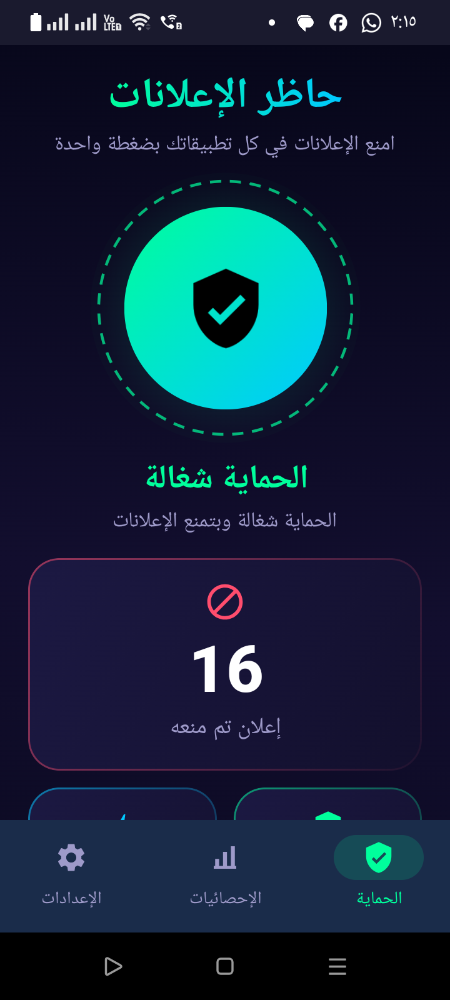
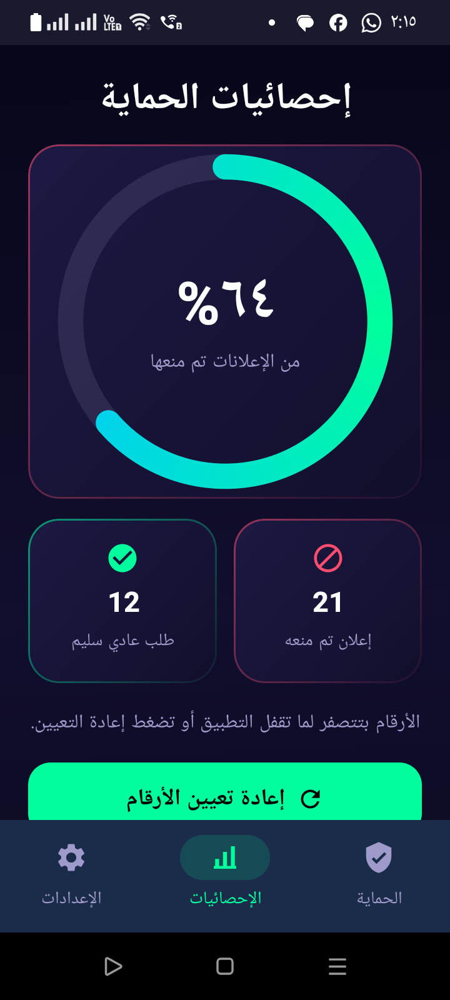
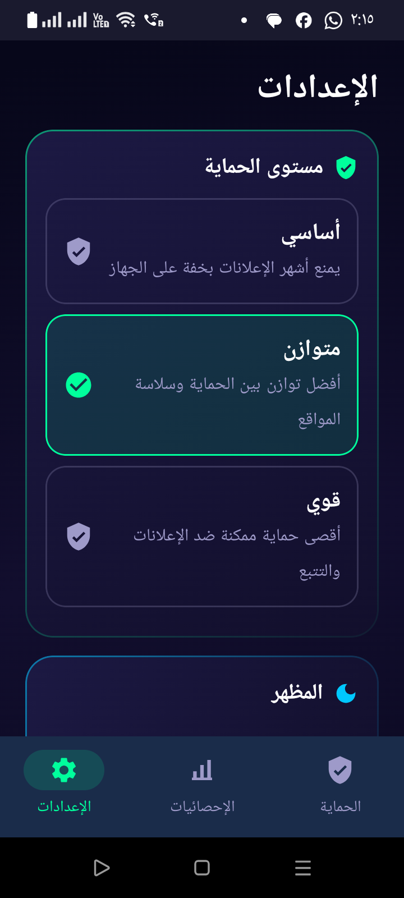

# Ad Blocker

A lightweight Android app that blocks ads and trackers in **all apps** using local DNS filtering. No root required.

<p align="center">
  
</p>

---

## Table of Contents

- [Features](#features)
- [Screenshots](#screenshots)
- [Download](#download)
- [Compatibility](#compatibility)
- [How It Works](#how-it-works)
- [Protection Levels](#protection-levels)
- [Building From Source](#building-from-source)
- [Project Structure](#project-structure)
- [Known Limitations](#known-limitations)
- [Blocklist Credits](#blocklist-credits)
- [Dedication](#dedication)

---

## Features

- **One-tap protection.** A single button starts and stops blocking.
- **Works system-wide.** Blocks ads in apps and browsers, not just one app.
- **No root.** Uses Android's built-in `VpnService` locally; nothing is sent to an external VPN server.
- **Fast startup.** Blocklists are bundled in the app and cached after the first start.
- **Three protection levels.** Basic, Balanced and Strong.
- **Live statistics.** Blocked count and block rate.
- **Light and dark themes.**
- **Optional auto-start** after the phone reboots.

## Screenshots

> Screenshots are in [`media/screens/`](media/screens).

| Home | Statistics | Settings |
|:---:|:---:|:---:|
|  |  |  |

## Download

Get the latest signed APK from the **[Releases](../../releases)** page:

| File | Description |
|---|---|
| `AdBlocker-v1.2.0-release.apk` | Signed release build (recommended) |

To install, open the APK on your phone and allow installing from unknown sources when prompted.

## Compatibility

| | |
|---|---|
| **Minimum Android** | 5.0 Lollipop (API 21) |
| **Target Android** | 14 (API 34) |
| **CPU architectures** | All (arm, arm64, x86, x86_64). The app has no native code, so one APK runs on every device. |

## How It Works

1. When protection starts, the app creates a **local** VPN interface that captures **only DNS queries**. All other traffic goes straight to the internet as usual.
2. Each queried domain, and every parent domain (`ads.example.com` → `example.com`), is checked against the active blocklist.
3. **Blocked** domains get an `NXDOMAIN` ("does not exist") reply, so the ad never loads.
4. **Allowed** domains are forwarded to a real DNS server (`1.1.1.1`, with `8.8.8.8` as fallback).

For speed, domains are stored as a sorted array of 64-bit hashes and looked up with binary search. The array is cached to disk after the first start.

## Protection Levels

| Level | Lists used | Best for |
|---|---|---|
| **Basic** | StevenBlack, Peter Lowe | Older or low-memory phones |
| **Balanced** *(default)* | OISD, StevenBlack, AdGuard DNS, Peter Lowe | Everyday use |
| **Strong** | All of the above + HaGeZi Ultimate, EasyList | Maximum blocking (may break a few sites) |

OISD is downloaded on first start. All other lists are bundled in the app.

## Building From Source

### Requirements

- JDK 17
- Android SDK with platform **34** and build-tools **34.0.0**

### Steps

1. Create `local.properties` in the project root:
   ```properties
   sdk.dir=C\:\\path\\to\\Android\\Sdk
   ```
2. Build:
   ```bash
   ./gradlew assembleDebug      # debug APK
   ./gradlew assembleRelease    # release APK
   ```
3. Output is written to `app/build/outputs/apk/<buildType>/AdBlocker-v<version>-<buildType>.apk`.

### Release signing (optional)

Create `keystore.properties` in the project root (it is git-ignored):

```properties
storeFile=/absolute/path/to/your-release.jks
storePassword=...
keyAlias=...
keyPassword=...
```

Without this file, `assembleRelease` still works but produces an **unsigned** APK.

## Project Structure

```
app/src/main/
├── kotlin/com/adblocker/app/
│   ├── MainActivity.kt            # Navigation, VPN permission, animated background
│   ├── data/Blocklist.kt          # Lists, parser, hashed domain store, cache, stats
│   ├── service/
│   │   ├── AdBlockerVpnService.kt # Local VPN + DNS filtering
│   │   └── DnsPacket.kt           # IPv4/UDP/DNS packet parsing and replies
│   ├── receiver/BootReceiver.kt   # Optional auto-start after reboot
│   ├── viewmodel/MainViewModel.kt # UI state and settings
│   └── ui/                        # Jetpack Compose screens, components, theme
├── assets/lists/                  # Bundled blocklists
└── res/                           # Icons, colors, themes
```

## Known Limitations

- **Encrypted DNS.** Apps or browsers that use DNS-over-HTTPS, or a phone with **Private DNS** enabled, can bypass the blocker. Turn off Private DNS under *Settings → Network → Private DNS* for best results.
- **Same-domain ads.** Ads served from the same domain as the content (for example, some YouTube ads) cannot be blocked at the DNS level.
- **One VPN at a time.** Android allows only one active VPN, so this app can't run together with another VPN app.
- **Testing.** Tested on one physical device. Android 5–7 support has been built for but not tested on real devices.

## Blocklist Credits

This app bundles or downloads the following community lists. Each list keeps its own license:

- [HaGeZi DNS Blocklists](https://github.com/hagezi/dns-blocklists)
- [OISD](https://oisd.nl)
- [StevenBlack Hosts](https://github.com/StevenBlack/hosts)
- [Peter Lowe's Ad Servers List](https://pgl.yoyo.org/adservers/)
- [AdGuard DNS Filter](https://github.com/AdguardTeam/AdGuardSDNSFilter)
- [EasyList](https://easylist.to)

## Dedication

Made with love as a gift for my mother. ❤️
